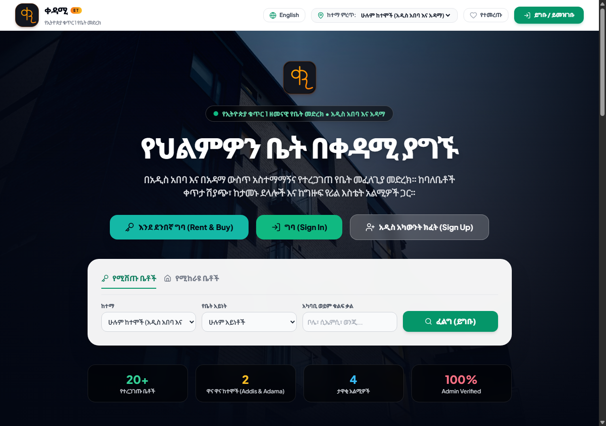
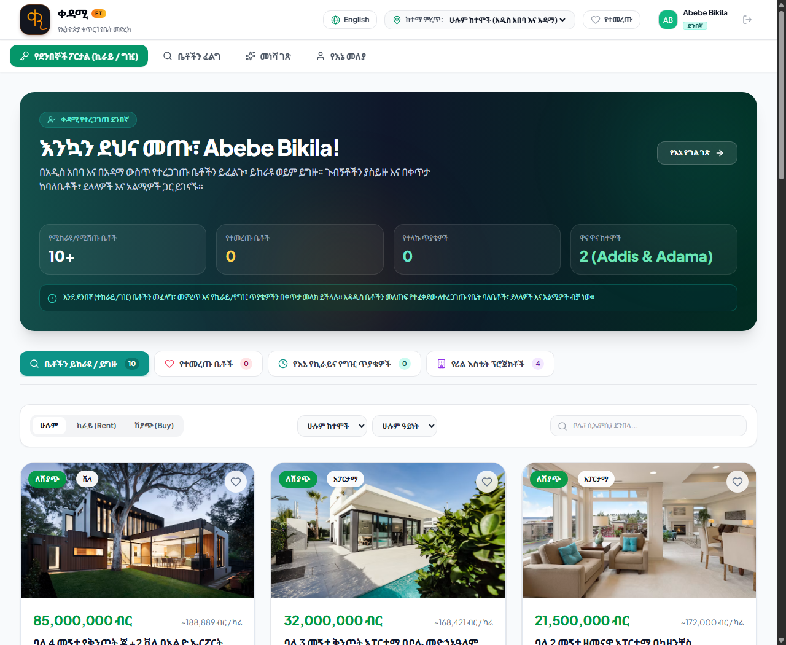
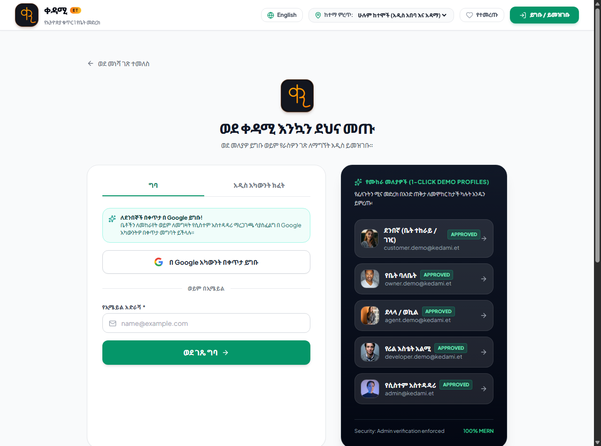
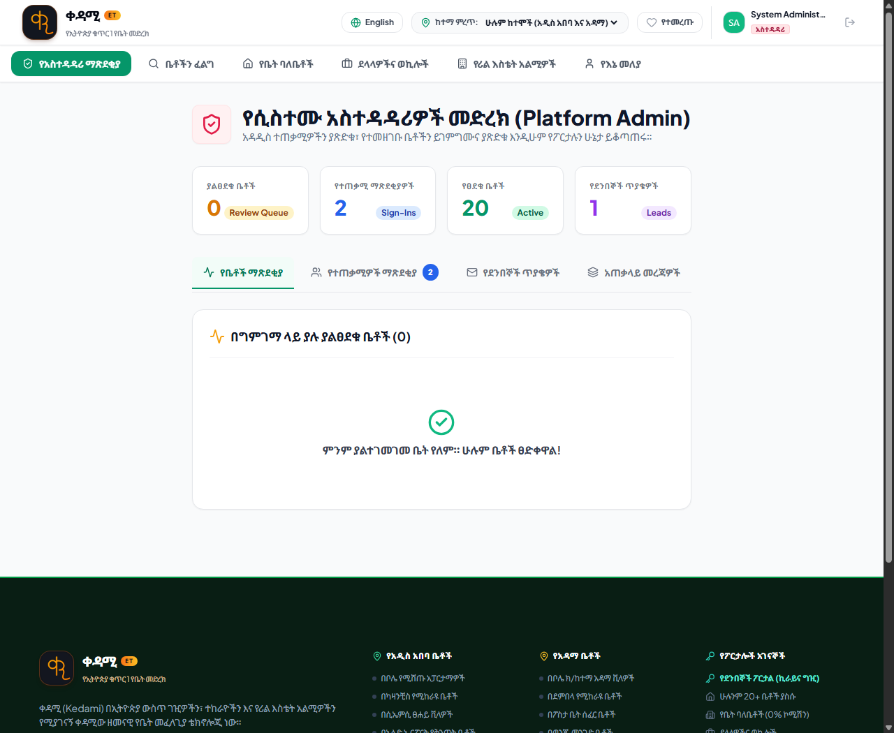

# ቀዳሚ (Kedami) - Ethiopian Real Estate MERN Portal

<div align="center">
  
  <h3>የኢትዮጵያ ቁጥር 1 ዘመናዊ የቤት መፈለጊያ ፖርታል</h3>
  <p><strong>Addis Ababa (አዲስ አበባ) & Adama (አዳማ) • 100% MERN Stack • Bilingual Amharic & English</strong></p>
</div>

---

## 📸 Project Screenshots

### 1. Modern Landing Page (Public View)
> Visitors land on a sleek, responsive landing page with prominent search filters, language switcher, and authentication actions. Role-specific navigation remains cleanly hidden until login.



---

### 2. Customer Portal — Rent & Buy (የደንበኞች ፖርታል)
> Tailored interface for homebuyers and renters to browse 20+ verified listings across Addis Ababa and Adama with Ethiopian Birr (ETB) pricing, schedule in-person tours, and track inquiries in real-time.



---

### 3. Authentication & 1-Click Demo Profiles (የመግቢያ ገጽ)
> Direct Google Account sign-in for customers and email credentials for all roles, along with instant 1-Click Demo Profiles for testing every permission tier.



---

### 4. Platform Administrator Console & Linked Footer (የሲስተሙ አስተዳዳሪዎች)
> Comprehensive platform KPI dashboard and admin review queue to inspect, approve, or reject new user registrations and property submissions, paired with a fully interactive locality-linked footer.



---

## 🇪🇹 Key Features

- **MERN Stack Architecture**: Pure JavaScript / Node.js throughout: MongoDB + Mongoose, Express.js REST API, React 19 (Vite) frontend, Node.js runtime.
- **Hero Landing Page (First View for Visitors)**:
  - Visitors land directly on the animated landing page showcasing prime residences across Addis Ababa and Adama.
  - **Hidden Role Navigation**: The role navigation bar is strictly hidden until the user signs in or registers, keeping the initial interface clean, intuitive, and welcoming.
  - Prominent **Sign In / Sign Up** buttons guide visitors to authenticate or create their accounts.
- **Role-Based Authentication & Dynamic Routing**:
  - Sign in with Google Account or email address, or choose **Sign Up** to create a new profile with a chosen role (Owner, Broker, Developer, Customer).
  - **Dynamic Post-Login Rendering**: Upon authentication, users are automatically routed directly to their role-specific dashboard (e.g. Owners to Owner Portal, Brokers to Agent Portal, Developers to Developer Portal, Admin to Admin Portal, Customers to Customer Hub).
  - Navigation tabs dynamically adapt to the authenticated user's permission level.
- **Dedicated Customer Role & Portal (Rent & Buy)**:
  - **Direct Google Sign-In**: Customers can sign in directly using their Google account without requiring admin review wait times (`status: 'approved'`).
  - **Rent & Buy Hub**: Filter by Rent vs. Buy, Addis Ababa & Adama localities, property types, and ETB pricing tiers.
  - **Tour Scheduling & Instant Requests**: Schedule in-person property viewing tours or send direct rent/buy inquiries to landlords and developers.
  - **Customer Inquiry Tracker**: Track all submitted requests and communication history in real-time.
  - **Role Boundaries**: Clear permissions model where customers can rent, buy, schedule visits, and save favorites, while property creation is exclusively reserved for verified Owners, Agents, and Developers.
  - **Personal Profile**: Customers have full access to manage their profile credentials, contact info, and bookmarked homes.
- **Dedicated User Profile (`ProfilePage`)**:
  - Each authenticated user has their own profile page showing personal information, role badge, approval status, city, company, and quick metrics (properties listed, bookmarked homes).
  - Inline profile editing allowing users to update their full name, phone number, city, and company with backend persistence (`PATCH /api/auth/users/:id/profile`).
- **1-Click Demo Profiles for Rapid Testing**:
  - 🛡️ **Platform Administrator**: `admin@kedami.et`
  - 🔑 **Customer / Seeker Demo**: `customer.demo@kedami.et`
  - 🏠 **Property Owner Demo**: `owner.demo@kedami.et`
  - 🏢 **Real Estate Broker Demo**: `agent.demo@kedami.et`
  - 🏗️ **Developer Rep Demo**: `developer.demo@kedami.et`
- **Dual Administrator Approval Governance**:
  1. 👤 **User Sign-In Approvals**: New self-registered users entering roles (Owner, Broker, Developer) are held in an Admin Review Queue until approved.
  2. 🏠 **Property Listing Approvals**: Newly submitted properties from owners, brokers, and developers enter the review queue with photos and pricing before going live publicly.
- **Multi-Photo Image Uploads**:
  - Direct local file upload from device with preview thumbnails.
  - Image URL input.
  - Curated Ethiopian property sample photo chips (Bole Modern Flat, Old Airport Villa, Adama Townhouse, Living Room, European Kitchen).
  - Multi-image gallery carousel in property inspection modal.
- **Dedicated Portals for Every Role**:
  1. 🔑 **Customers / Renters & Buyers (የደንበኞች ፖርታል - ኪራይና ግዢ)**: Browse and filter verified properties to rent or buy, request in-person viewing tours, submit inquiries directly to landlords/developers, and track communications.
  2. 🔍 **Public Search (ዋናው መፈለጊያ)**: Browse 20 verified properties across Addis Ababa and Adama with dynamic ETB budget tiers, Buy/Rent toggle, Flat/House filter, and interactive contact modal.
  3. 🏠 **Property Owners (የቤት ባለቤቶች)**: Individual landlords & homeowners can post their flat or house directly for sale or rent with 0% brokerage fees and upload multiple photos.
  4. 💼 **Agents & Brokers (ደላላዎች / ወኪሎች)**: Multi-property management dashboard with agency branding, photo uploads, and a real-time Client Leads Inbox.
  5. 🏗️ **Builders & Real Estate Developers (የሪል እስቴት አልሚዎች)**: Showcase mega residential projects (e.g. Ayat Real Estate, Tsehay Real Estate, Noah Real Estate, Flintstone Homes) with total units, handover year, and project master plans.
  6. 🛡️ **Platform Administrators (የሲስተሙ አስተዳዳሪዎች)**: Platform KPI statistics and review queue to verify, approve (ያጽድቁ), or reject (ውድቅ ያድርጉ) new user registrations and property submissions.
- **Interactive Fully-Linked Footer (`Footer.jsx`)**:
  - **Clickable City & Locality Searches**: Every location listed under Addis Ababa (Bole, Kazanchis, CMC, Old Airport, Sarbet, Ayat) and Adama (Bole Sub-City, Dembela, Posta Bet, Wonji Road, Boku, Geda) is an active filter link that automatically navigates to search results matching that locality.
  - **Direct Role Portal Routing**: Immediate one-click links to Customer Portal, Owner Portal, Agent Dashboard, Developer Projects, and Admin Console.
  - **Live Contact Actions**: One-click phone calling (`tel:`), email drafting (`mailto:`), and official Telegram channel (`@kedami_et`).
  - **Interactive Legal Dialogs**: Clickable modals for Terms of Service, Privacy Policy, Safety & Verification, and FAQ.
- **Bilingual Amharic (አማርኛ) / English**: Seamless one-click language toggle across all search filters, role forms, specifications, and notifications.
- **Ethiopian Cities**: Addis Ababa (Bole, CMC, Kazanchis, Old Airport, Sarbet, Ayat, Summit, Lebu, Gerji) and Adama (Bole Sub-City, Dembela, Posta Bet, Wonji Road, Boku, Geda).
- **ETB Currency**: Native formatting in Ethiopian Birr (`ብር` / `ETB`) with calculated rates per square meter (~ETB/m²).
- **Responsive Mobile-First UI/UX**: Mobile hamburger drawer, adaptive card grids, touch-friendly buttons, and responsive modal viewers.

---

## 💻 Local Development Setup

### 1. Backend (Express & MongoDB)
```bash
cd backend
npm install
npm start
```
The server will start on `http://localhost:8000`. If a local or remote MongoDB instance is configured via `MONGODB_URI`, it connects automatically; otherwise, it operates in resilient fallback mode pre-loaded with the 20 Ethiopian listings, developer projects, and demo users.

### 2. Frontend (React + Vite)
```bash
cd frontend
npm install
npm run dev
```
Open [http://localhost:3000](http://localhost:3000) in your web browser.
